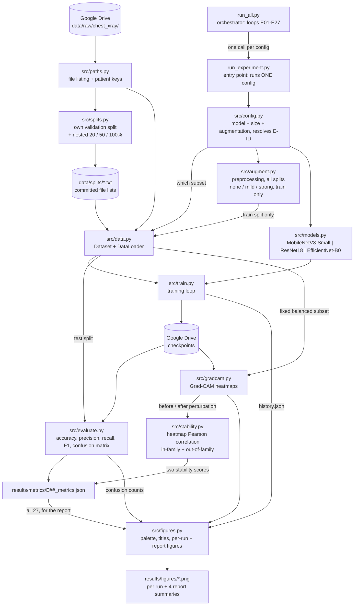

# System Architecture

Block diagram of the experiment pipeline, and the mapping from each block to the Python file
that implements it.

> **Status:** the modules below are being built out. The Status column says where each one
> stands — *Done* means implemented and exercised, *Stub* means the file exists with its
> documented contract but no logic yet, *Planned* means not yet created. This document is the
> source of truth for how the system is organized; if the code structure changes, this diagram
> changes with it in the same pass.

## Block diagram

## Block to file mapping

| Block | File | Responsibility | Status |
|---|---|---|---|
| Orchestrator | `run_all.py` | Loops over all 27 configs, or the sixteen tuning runs with `--tuning`, calling the single-experiment entry point for each. Skips configs whose outputs already exist, so a dropped session costs one experiment, not the sweep; `--force` re-runs them. A run that fails is reported and the sweep continues; rerunning retries it. | Done |
| Entry point | `run_experiment.py` | Runs exactly one experiment, identified by its ID (E01-E27 or T01-T16): trains it, then evaluates it - on the test split for an E run, on validation only for a T run. The only place an experiment is launched from. A finished experiment is skipped; `--reevaluate` redoes only its evaluation, `--force` retrains. Records the code's commit, GPU and timing in the results file. | Done |
| Config | `src/config.py` | Every run as a frozen `RunConfig`: E01-E27 generated in `experiments/experiment_log.md` order and checked against it, plus the sixteen tuning runs T01-T16 and the shared `RECIPE`. `run_title` gives every figure and table the same label for a run. | Done |
| Paths | `src/paths.py` | Locates the image files and reads identity out of their filenames, through two deliberately different keys: `patient_key` is the best reading of patient identity (used by the survey), and `group_key` decides which images must stay together when splitting - coarser for PNEUMONIA (`person<N>` without the infection type), so it cannot leak under either reading of the filenames. The one module that knows the folder layout and the naming conventions, so the survey and the pipeline cannot disagree about either. Resolves the dataset location through `$PNEUMONIA_DATA_ROOT`, falling back to the repo's `data/raw/chest_xray`. | Done |
| Splits | `src/splits.py` | Builds our own validation split out of the combined official train + val, grouped by `group_key` so no group spans train and validation, then the nested 20% / 50% / 100% training subsets as prefixes of one seeded per-class shuffle. Writes the file lists to `data/splits/` and asserts both invariants. Validation and test are never subsampled. | Done |
| Data | `src/data.py` | PyTorch `Dataset` and `DataLoader` over the committed file lists. Labels come from the parent folder name, with PNEUMONIA as the positive class, since precision/recall/F1 are defined relative to it. Every image is converted to grayscale at load, before any transform, so colour mode can never reach the model. Shuffle order and worker seeds come from a dedicated seeded generator. `load_split` refuses to return a list naming files that do not exist. | Done |
| Augmentation | `src/augment.py` | Two jobs: the deterministic preprocessing applied to **all** splits (grayscale → 3 channels, squash to 224×224, ImageNet normalisation), and the three random regimes (none / mild / strong) from `experiments/augmentation_plan.md`, applied to the **training split only** - enforced by `build_transform(regime, train=False)` returning preprocessing alone. Magnitudes live in one `REGIMES` dict mirroring `augmentation_plan.md`. `python -m src.augment` self-checks and renders preview sheets. | Done |
| Models | `src/models.py` | Factory returning any of the three architectures with ImageNet weights and a new two-logit output layer. One `ARCHITECTURES` table records, per architecture, the head, the Grad-CAM layer (`features.12` / `layer4` / `features.8`, all 7×7) and what stays trainable under partial fine-tuning. Also owns freezing (`set_fine_tuning`), the head/backbone parameter groups (`split_parameters`) and `train_mode`, which keeps frozen BatchNorm layers in eval. `python -m src.models` self-checks the structure. | Done |
| Training | `src/train.py` | Architecture-agnostic training loop. Checkpoints the best validation balanced accuracy to Drive in a form Grad-CAM can hook into, early-stops on patience, and resumes an interrupted run from `last.pt` with per-epoch reseeding. Logs a line per epoch to the terminal and to `train.log`. | Done |
| Evaluation | `src/evaluate.py` | ROC-AUC, balanced accuracy, accuracy, precision, recall, specificity and F1, shared by per-epoch validation and the final test run so the two cannot diverge. For an experiment, first chooses a decision threshold on validation with the selected checkpoint (the one maximising balanced accuracy) and then scores the test set at 0.5 and at that threshold (NOTES.md #27). Writes `results/metrics/<ID>[_seed<N>]_metrics.json` in the schema NOTES.md #13 records, with 95% confidence intervals from a percentile bootstrap over patient groups. | Done, stability fields pending |
| Figures | `src/figures.py` | Every figure in the project and the palette they share. Per run: training curves and the confusion matrix, at 0.5 and at the validation-chosen threshold side by side. For the report: ROC-AUC and F1 (at the validation-chosen threshold) against data size, one panel per architecture and a line per augmentation regime with confidence intervals, plus Grad-CAM stability and the in-family minus out-of-family gap. Each PNG carries its title inside the file, and `python -m src.figures --audit` checks all 97 per-run figures (three per experiment plus the sixteen tuning runs' training curves) against the config that should have produced them. `--report` draws the summary figures and `results/summary_table.md` from the results files; the self-check draws into a temporary folder, never the results. | Done |
| Grad-CAM | `src/gradcam.py` | A forward hook on each architecture's Grad-CAM layer (the last 7×7 stage) captures the activations; `torch.autograd.grad` gives the gradient of the target class's pre-softmax logit; Eq. 1 averages it per channel and Eq. 2 takes the ReLU of the weighted sum - raw 7×7 maps plus an empty-map flag, upsampled to image size on request (Selvaraju et al. Eq. 1–2). Batched, in eval mode. Draws an examples figure. `python -m src.gradcam` checks every architecture against closed forms computed without the hook; `--id T13 --output …` explains a trained run's validation images and runs the model-randomisation test. | Done; E-run wiring with stability |
| Stability | `src/stability.py` | Grad-CAM stability on a fixed test subset (`data/splits/stability_subset.txt`: every NORMAL test image and 234 PNEUMONIA, drawn once by seed). Each map explains the image's true class and is compared, by **Pearson correlation**, with the map of the same image perturbed two ways: **in-family** (rotation by +5 and -5 degrees, the map rotated back and compared only where both frames overlap) and **out-of-family** (Gaussian noise, one grayscale draw per image, seeded, its size fixed by a validation calibration - NOTES.md #7). Reports both means, their gap, 95% patient-group intervals and a block of diagnostics (flip rates, chance baseline, cosine, correct-only means); saves per-image results and the raw maps beside the checkpoint. `python -m src.stability` self-checks; `--calibrate` runs the noise calibration on validation. | Done (rotation +/-5 degrees, noise sigma 0.02 - provisional, NOTES.md #7, #29) |

## Design notes

**Why two entry points rather than one script.** Training runs on Google Colab, where sessions
time out and the filesystem is ephemeral. A single monolithic "run everything" script would
mean one disconnect part-way through costs the entire sweep. Splitting into a
single-experiment entry point plus a thin orchestrator means any individual experiment can be
run, debugged, or re-run in isolation, and the sweep can resume where it stopped.

**Why one models file rather than three.** The three architectures differ only in which
torchvision backbone is loaded and which classifier head is replaced. Three near-identical
files would drift apart; one factory function keeps them provably consistent — which matters,
since the whole experiment depends on the three being trained identically.

**Where partial fine-tuning draws the line.** "Train the last stage" is not comparable across
the three as a literal rule: ResNet18's last stage holds 75% of its convolutional parameters,
while the last block of MobileNetV3-Small or EfficientNet-B0 holds about 30%. The boundary is
therefore every block at the final 7×7 resolution plus the classifier - `layer4` in ResNet18,
`features.9`-`12` in MobileNetV3-Small, `features.6`-`8` in EfficientNet-B0 - which leaves 75%,
79% and 79% of the convolutional parameters trainable and is exactly the resolution Grad-CAM
reads. Frozen layers are also kept in evaluation mode during training, because
`requires_grad=False` alone does not stop BatchNorm updating its running statistics, and those
would then drift differently under each augmentation regime.

**Why Grad-CAM comes before the full sweep.** Grad-CAM needs trained weights. Building it
after running all 27 experiments risks discovering that checkpoints were saved in an unusable
form, forcing every run to be repeated. Instead, one pilot config is taken end-to-end
(train → evaluate → Grad-CAM → stability → saved outputs) before the remaining 26 are launched.

**Why the split file lists are committed.** `data/splits/*.txt` are generated, but they are
checked in anyway, because they are not data — they are the *definition of the experiment*.
Committed, anyone can see exactly which images trained which model and reproduce a result
without rerunning the generator, and `python -m src.splits` must reproduce them byte for byte.
That diff is the reproducibility test: if a change to sorting, seeding or Python version were
ever to reshuffle a split, it shows up as a diff rather than as an unexplained change in the
numbers. The lists store paths relative to the dataset root, with forward slashes and `\n` line
endings, so one committed file is valid on Windows, Linux and Colab alike.

**Why `src/paths.py` exists separately.** Both the dataset survey and the training pipeline need
to list images and derive a patient identity from a filename. Two copies of that logic would be
free to drift, and the failure mode is silent: a slightly different patient key puts the same
patient in both train and validation, and every validation score comes out flattering. One
module, imported by both, makes that impossible.

**How the dataset location is resolved.** `paths.data_root()` returns `$PNEUMONIA_DATA_ROOT`
when set and the repo's `data/raw/chest_xray` otherwise. Locally the fallback is right; on
Colab the notebook unpacks the dataset to `/content` and sets the variable. One code path
serves both, and no module hardcodes a machine-specific location.

**Where outputs live.** Metrics and figures follow the naming and schema defined in
`results/README.md`. Checkpoints and the dataset live in Google Drive, never on the Colab
session disk.
