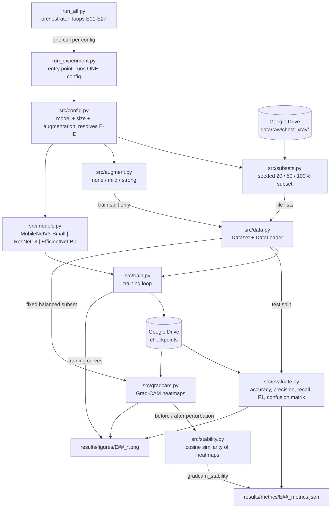

# System Architecture

Block diagram of the experiment pipeline, and the mapping from each block to the Python file
that implements it.

> **Status:** this describes the *planned* structure. The modules below are being built out —
> see the block-to-file table for what exists so far. This document is the source of truth for
> how the system is organized; if the code structure changes, this diagram changes with it.

## Block diagram

## Block to file mapping

| Block | File | Responsibility | Status |
|---|---|---|---|
| Orchestrator | `run_all.py` | Loops over all 27 configs, calling the single-experiment entry point for each. Skips configs whose outputs already exist, so a dropped session costs one experiment, not the sweep. | Planned |
| Entry point | `run_experiment.py` | Runs exactly one experiment, identified by its config or E-ID. The only place an experiment is launched from. | Planned |
| Config | `src/config.py` | Resolves a (model, data size, augmentation) triple to its `E01`–`E27` ID, matching `experiments/experiment_log.md`. Carries the random seed. | Planned |
| Subsets | `src/subsets.py` | Generates the reproducible 20% / 50% / 100% training subsets from a fixed seed, writing explicit file lists so they're inspectable and regenerable. Validation and test splits are never subsampled. | Planned |
| Data | `src/data.py` | PyTorch `Dataset` and `DataLoader` over the chest X-ray images. | Planned |
| Augmentation | `src/augment.py` | The three regimes (none / mild / strong) exactly as defined in `experiments/augmentation_plan.md`. Applied to the training split only. | Planned |
| Models | `src/models.py` | Factory returning any of the three architectures with a binary classification head. One file rather than three, since they differ only by backbone. | Planned |
| Training | `src/train.py` | Architecture-agnostic training loop. Saves checkpoints to Drive in a form Grad-CAM can later hook into. | Planned |
| Evaluation | `src/evaluate.py` | Classification metrics and confusion matrices, per the schema in `results/README.md`. | Planned |
| Grad-CAM | `src/gradcam.py` | Forward/backward hooks on the last conv layer; computes the neuron importance weights and the ReLU'd weighted activation map (Selvaraju et al. Eq. 1–2). | Planned |
| Stability | `src/stability.py` | Cosine similarity between normalized Grad-CAM heatmaps before and after a small input perturbation, averaged over a fixed class-balanced test subset. | Planned |

## Design notes

**Why two entry points rather than one script.** Training runs on Google Colab, where sessions
time out and the filesystem is ephemeral. A single monolithic "run everything" script would
mean one disconnect part-way through costs the entire sweep. Splitting into a
single-experiment entry point plus a thin orchestrator means any individual experiment can be
run, debugged, or re-run in isolation, and the sweep can resume where it stopped.

**Why one models file rather than three.** The three architectures differ only in which
torchvision backbone is loaded and which classifier head is replaced. Three near-identical
files would drift apart; one factory function keeps them provably consistent — which matters,
since the whole experiment depends on the three being trained identically.

**Why Grad-CAM comes before the full sweep.** Grad-CAM needs trained weights. Building it
after running all 27 experiments risks discovering that checkpoints were saved in an unusable
form, forcing every run to be repeated. Instead, one pilot config is taken end-to-end
(train → evaluate → Grad-CAM → stability → saved outputs) before the remaining 26 are launched.

**Where outputs live.** Metrics and figures follow the naming and schema defined in
`results/README.md`. Checkpoints and the dataset live in Google Drive, never on the Colab
session disk.
