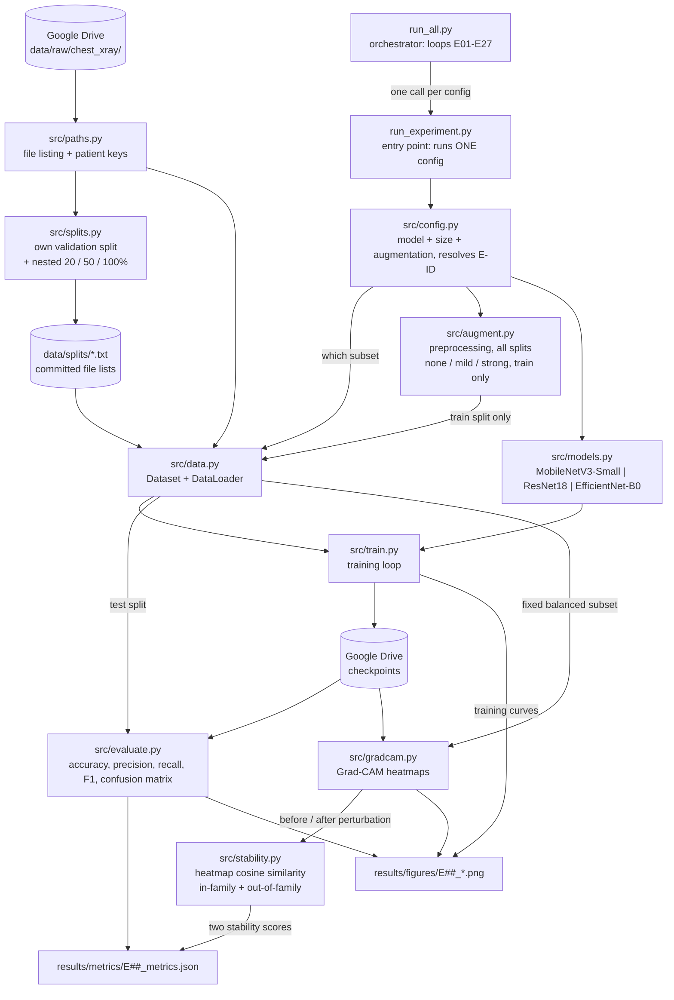

# System Architecture

Block diagram of the experiment pipeline, and the mapping from each block to the Python file
that implements it.

> **Status:** the modules below are being built out. The Status column says where each one
> stands — *Done* means implemented and exercised, *Stub* means the file exists with its
> documented contract but no logic yet, *Planned* means not yet created. This document is the
> source of truth for how the system is organized; if the code structure changes, this diagram
> changes with it in the same pass.

## Block diagram

## Block to file mapping

| Block | File | Responsibility | Status |
|---|---|---|---|
| Orchestrator | `run_all.py` | Loops over all 27 configs, calling the single-experiment entry point for each. Skips configs whose outputs already exist, so a dropped session costs one experiment, not the sweep. | Stub |
| Entry point | `run_experiment.py` | Runs exactly one experiment, identified by its config or E-ID. The only place an experiment is launched from. | Stub |
| Config | `src/config.py` | Resolves a (model, data size, augmentation) triple to its `E01`–`E27` ID, matching `experiments/experiment_log.md`. Carries the random seed. | Stub |
| Paths | `src/paths.py` | Locates the image files and reads identity out of their filenames, through two deliberately different keys: `patient_key` is the best reading of patient identity (used by the survey), and `group_key` decides which images must stay together when splitting - coarser for PNEUMONIA (`person<N>` without the infection type), so it cannot leak under either reading of the filenames. The one module that knows the folder layout and the naming conventions, so the survey and the pipeline cannot disagree about either. Resolves the dataset location through `$PNEUMONIA_DATA_ROOT`, falling back to the repo's `data/raw/chest_xray`. | Done |
| Splits | `src/splits.py` | Builds our own validation split out of the combined official train + val, grouped by `group_key` so no group spans train and validation, then the nested 20% / 50% / 100% training subsets as prefixes of one seeded per-class shuffle. Writes the file lists to `data/splits/` and asserts both invariants. Validation and test are never subsampled. | Done |
| Data | `src/data.py` | PyTorch `Dataset` and `DataLoader` over the committed file lists. Labels come from the parent folder name, with PNEUMONIA as the positive class, since precision/recall/F1 are defined relative to it. Every image is converted to grayscale at load, before any transform, so colour mode can never reach the model. Shuffle order and worker seeds come from a dedicated seeded generator. `load_split` refuses to return a list naming files that do not exist. | Done |
| Augmentation | `src/augment.py` | Two jobs: the deterministic preprocessing applied to **all** splits (grayscale → 3 channels, squash to 224×224, ImageNet normalisation), and the three random regimes (none / mild / strong) from `experiments/augmentation_plan.md`, applied to the **training split only** - enforced by `build_transform(regime, train=False)` returning preprocessing alone. Magnitudes live in one `REGIMES` dict mirroring `augmentation_plan.md`. `python -m src.augment` self-checks and renders preview sheets. | Done |
| Models | `src/models.py` | Factory returning any of the three architectures with a binary classification head. One file rather than three, since they differ only by backbone. | Stub |
| Training | `src/train.py` | Architecture-agnostic training loop. Saves checkpoints to Drive in a form Grad-CAM can later hook into. | Stub |
| Evaluation | `src/evaluate.py` | Classification metrics and confusion matrices, per the schema in `results/README.md`. | Stub |
| Grad-CAM | `src/gradcam.py` | Forward/backward hooks on the last conv layer; computes the neuron importance weights and the ReLU'd weighted activation map (Selvaraju et al. Eq. 1–2). | Stub |
| Stability | `src/stability.py` | Cosine similarity between normalized Grad-CAM heatmaps before and after a small input perturbation, averaged over a fixed class-balanced test subset. Measured two ways: **in-family** (a small rotation, with the heatmap rotated back into alignment and out-of-frame corners masked) and **out-of-family** (small Gaussian noise, which no augmentation regime uses). Reporting both keeps the metric from favouring augmented models by construction. | Stub |

## Design notes

**Why two entry points rather than one script.** Training runs on Google Colab, where sessions
time out and the filesystem is ephemeral. A single monolithic "run everything" script would
mean one disconnect part-way through costs the entire sweep. Splitting into a
single-experiment entry point plus a thin orchestrator means any individual experiment can be
run, debugged, or re-run in isolation, and the sweep can resume where it stopped.

**Why one models file rather than three.** The three architectures differ only in which
torchvision backbone is loaded and which classifier head is replaced. Three near-identical
files would drift apart; one factory function keeps them provably consistent — which matters,
since the whole experiment depends on the three being trained identically.

**Why Grad-CAM comes before the full sweep.** Grad-CAM needs trained weights. Building it
after running all 27 experiments risks discovering that checkpoints were saved in an unusable
form, forcing every run to be repeated. Instead, one pilot config is taken end-to-end
(train → evaluate → Grad-CAM → stability → saved outputs) before the remaining 26 are launched.

**Why the split file lists are committed.** `data/splits/*.txt` are generated, but they are
checked in anyway, because they are not data — they are the *definition of the experiment*.
Committed, anyone can see exactly which images trained which model and reproduce a result
without rerunning the generator, and `python -m src.splits` must reproduce them byte for byte.
That diff is the reproducibility test: if a change to sorting, seeding or Python version were
ever to reshuffle a split, it shows up as a diff rather than as an unexplained change in the
numbers. The lists store paths relative to the dataset root, with forward slashes and `\n` line
endings, so one committed file is valid on Windows, Linux and Colab alike.

**Why `src/paths.py` exists separately.** Both the dataset survey and the training pipeline need
to list images and derive a patient identity from a filename. Two copies of that logic would be
free to drift, and the failure mode is silent: a slightly different patient key puts the same
patient in both train and validation, and every validation score comes out flattering. One
module, imported by both, makes that impossible.

**How the dataset location is resolved.** `paths.data_root()` returns `$PNEUMONIA_DATA_ROOT`
when set and the repo's `data/raw/chest_xray` otherwise. Locally the fallback is right; on
Colab the notebook unpacks the dataset to `/content` and sets the variable. One code path
serves both, and no module hardcodes a machine-specific location.

**Where outputs live.** Metrics and figures follow the naming and schema defined in
`results/README.md`. Checkpoints and the dataset live in Google Drive, never on the Colab
session disk.
