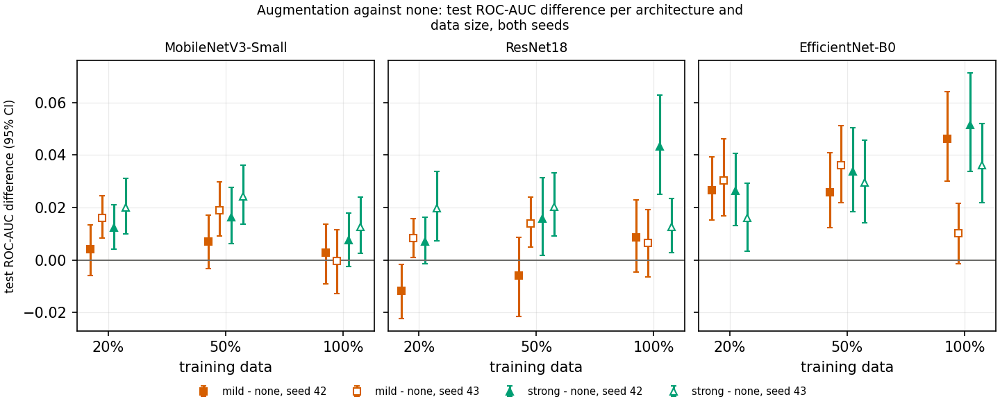

# Evaluating Augmentation Reliability in Limited-Data Chest X-Ray Pneumonia Detection Using Grad-CAM

**Or Bakish and Yotam Gilboa**

## 1. Introduction and Related Work

Deep learning has shown strong performance in medical image classification, including the detection of pneumonia from chest X-ray images. However, training deep neural networks usually requires a large amount of labeled data. In medical imaging this can be a significant limitation, since collecting and labeling data may require expert knowledge and can be expensive. Therefore, it is useful to understand how well pretrained models can perform when only a limited amount of training data is available, and whether data augmentation can reduce the performance loss.

In this project, we study binary classification of chest X-rays into Normal and Pneumonia classes. Our main goal is to examine how training-data size and augmentation strength affect both classification performance and the stability of model explanations. We compare three pretrained CNN architectures of different sizes: MobileNetV3-Small, ResNet18, and EfficientNet-B0. Each model is trained using 20%, 50%, and 100% of the available training data, with no augmentation, mild medically realistic augmentation, or stronger augmentation. This gives a total of 27 main experimental configurations.

Previous work by Kermany et al. [1] demonstrated that deep learning can be successfully applied to pediatric chest X-rays for pneumonia classification. Their work also introduced the dataset used in this project and showed that transfer learning can achieve strong classification performance on this task. While classification accuracy is important, it does not show which image regions influence the model's decision. Selvaraju et al. [2] introduced Grad-CAM, a method for producing class-specific heatmaps that highlight image regions that contribute to a CNN prediction.

Based on these ideas, we use Grad-CAM not only for visualization but also as an auditing tool. We compare how stable the explanation maps remain under small input perturbations and across different training settings. This allows us to study whether augmentation improves classification performance while also affecting the consistency of the visual evidence used by the model. The project therefore focuses on the trade-off between available training data, augmentation strength, classification performance, and explanation stability.

## 2. Dataset

We use the publicly available Chest X-Ray Images (Pneumonia) dataset by Kermany et al. The dataset contains 5,856 pediatric chest X-ray images divided into two classes: Normal and Pneumonia. The original dataset contains 5,216 training images, 16 validation images, and 624 test images. The training set is imbalanced, with 3,875 Pneumonia images and 1,341 Normal images.

Because the original validation set contains only 16 images, it is too small for reliable model selection and early stopping. We therefore combine the original training and validation sets and create a new validation split of approximately 15%. The official test set is kept unchanged and is not used during model selection or hyperparameter tuning. When creating the new split, related images are kept together using filename-derived patient or case grouping where possible, in order to reduce the risk of leakage between training and validation.

Exploratory data analysis showed several dataset properties that may affect model behavior. Pneumonia images are generally smaller and have a higher aspect ratio than Normal images. In addition, 283 images are stored as RGB, and all of them belong to the Pneumonia class, while the remaining images are grayscale. To prevent the model from using channel format as a shortcut, all images are converted to grayscale and then replicated to three channels before being passed to the pretrained networks.

The analysis also identified other possible shortcuts, including differences in framing, image borders, laterality markers, text overlays, and medical devices such as tubes and electrodes. These differences are not necessarily related to pneumonia itself, but may still correlate with the class label. For this reason, they are considered when interpreting both classification results and Grad-CAM explanations.

All images are resized directly to 224×224 pixels. Aspect-preserving padding was avoided because the amount of padding would itself be correlated with the original aspect ratio and therefore with the class label. Direct resizing keeps the full image content, although the geometric distortion it introduces is treated as a limitation of the preprocessing pipeline.

## 3. Methodology

### 3.1 Experimental Setup and Models

We evaluate three ImageNet-pretrained CNN architectures: MobileNetV3-Small, ResNet18, and EfficientNet-B0. The architectures differ in size and complexity, allowing us to examine whether augmentation and limited training data affect lightweight and larger models differently.

For each architecture, we train models using 20%, 50%, and 100% of the available post-split training pool. The limited-data subsets are nested, so the 20% subset is contained in the 50% subset, which is contained in the full training set. Sampling is stratified by class to preserve the original class distribution. Combined with the three augmentation regimes, this produces 27 experimental configurations.

A validation-only tuning phase was performed before the main experiments to select a common training recipe. Based on this tuning, all 27 configurations use partial fine-tuning and class-weighted cross-entropy. Partial fine-tuning updates the final high-level feature stage and classifier of each pretrained architecture while keeping earlier layers frozen.

### 3.2 Preprocessing and Data Augmentation

All input images are first converted to grayscale and then replicated into three identical channels to match the input format expected by ImageNet-pretrained models. Images are resized directly to 224×224 pixels and normalized using ImageNet statistics.

Three augmentation regimes are compared. The baseline uses no augmentation. The mild regime applies small rotations (up to ±5°), translations up to 2%, limited zoom, and brightness and contrast changes up to ±10%. The strong regime increases these magnitudes to rotations up to ±15°, translations up to 5%, stronger zoom-out, and brightness and contrast changes up to ±25%.

All augmentations were chosen to preserve clinically relevant image content. Horizontal flipping, random cropping, random erasing, and geometric warping were excluded because they may change anatomy, laterality, or remove visible pathology.

### 3.3 Training Protocol

All models are trained using AdamW with weight decay of 1e-4. The newly initialized classification layer uses a learning rate of 1e-3, while pretrained layers use 1e-4. Training uses a batch size of 32 for a maximum of 30 epochs, with early stopping after five epochs without improvement.

Checkpoint selection is based on validation balanced accuracy at the standard decision threshold of 0.5. Class-weighted cross-entropy is used to account for the training-set imbalance. The same training recipe is used for all architectures, data sizes, and augmentation regimes.

The complete 27-experiment sweep is repeated with two random seeds, 42 and 43, using the same code and experimental configuration. This allows us to estimate how sensitive the observed differences are to training randomness rather than relying on a single run.

### 3.4 Evaluation and Explanation Stability

Classification performance is evaluated using accuracy, precision, recall, specificity, F1-score, balanced accuracy, ROC-AUC, and confusion matrices. Confidence intervals are also reported for the main metrics. Threshold-dependent metrics are evaluated both at the standard threshold of 0.5 and at a threshold selected on the validation set to maximize balanced accuracy. The test set is not used for model selection or threshold tuning.

For comparisons across experimental conditions, results are summarized over both random seeds. A finding is considered strong when both seeds show the same direction of effect. The 95% confidence intervals are based on 2,000 patient-group bootstrap resamples and represent test-sampling uncertainty for a fixed trained model.

Grad-CAM is used to examine which image regions contribute to each model's prediction. Explanation stability is evaluated on a fixed class-balanced set of 468 test images, containing all 234 Normal images and 234 Pneumonia images. For each image, the original Grad-CAM heatmap is compared with heatmaps obtained after two small perturbations: rotations of ±5° as the in-family perturbation and Gaussian noise with σ = 0.02 as the out-of-family perturbation.

Heatmap similarity is measured using Pearson correlation, with the stability gap defined as in-family minus out-of-family correlation. Pearson was used instead of the cosine similarity originally proposed because Grad-CAM maps are non-negative after ReLU, which can make cosine similarity high even when the main activation regions differ. Pearson correlation removes each map's mean before comparison and therefore provides better separation between meaningful spatial agreement and shared positive background. For rotated inputs, the heatmap is aligned back to the original orientation before the comparison.

## 4. Results and Analysis

Strong augmentation produced the clearest and most consistent improvement in classification performance. Compared with no augmentation, ROC-AUC increased in all 9 architecture/data-size combinations in both seeds, with a median improvement of about 0.020. Mild augmentation also improved ROC-AUC in most configurations, but less consistently. The main threshold-dependent improvement was in specificity: strong augmentation reduced false positive predictions on Normal images, while recall remained almost unchanged because it was already very high across the experiments.

*Figure 1. Difference in test ROC-AUC between each augmentation regime and no augmentation, across architectures and training-data sizes for both random seeds.*

The benefit of augmentation was not limited to the smallest training set. Strong augmentation improved ROC-AUC at 20%, 50%, and 100% data for all three architectures, but the size of the improvement did not consistently increase or decrease with training-data size. Therefore, our results do not support the hypothesis that augmentation becomes more useful specifically when less training data is available.

Increasing the amount of training data also produced an unexpected result. On the official test set, ROC-AUC did not improve consistently and specificity generally decreased as more training data was used. This effect remained when using the threshold selected on validation: specificity decreased in 17 of 18 comparisons for seed 42 and 13 of 18 for seed 43. In contrast, validation specificity improved with more data. This suggests an operating-point shift between validation and test, which strong augmentation largely mitigated, especially at 100% training data.

The three architectures showed similar overall ROC-AUC, with no architecture consistently outperforming the others. Their main difference was in their response to augmentation. EfficientNet-B0 showed the largest average ROC-AUC improvement from augmentation, while ResNet18 showed the smallest. MobileNetV3-Small showed the most consistent improvement in explanation stability.

For Grad-CAM stability, strong augmentation increased the in-family minus out-of-family stability gap in 5 of 9 configurations in both seeds and decreased it in none. The increase was mainly caused by higher stability under rotation, with little consistent change under Gaussian noise. This indicates that augmentation mainly teaches invariance to transformations similar to those seen during training, rather than improving explanation stability in general. The same direction remained when only correctly classified images were considered and when empty Grad-CAM maps were counted as zero.

The shortcut analysis showed that several non-pathological image properties may influence the models. Although JPEG encoding strongly differed between the training classes, re-encoding the validation images did not reproduce the validation-to-test performance shift, so this shortcut was not supported by the intervention. In healthy test images, smaller original image size was correlated with predictions moving toward Pneumonia, although this result is correlational. Grad-CAM analysis also showed that pneumonia evidence was often concentrated near the upper corners and bottom of the image. Augmentation reduced this concentration consistently, suggesting that it can reduce some reliance on non-clinical image regions.

## 5. Discussion and Conclusion

The main result of this project is that stronger, clinically constrained augmentation improved pneumonia classification consistently across architectures and training-data sizes. However, the improvement was not stronger in the limited-data setting than with the full training set. This means that augmentation was useful throughout the experiment, but our results do not show that its value is specifically caused by data scarcity.

The explanation-stability results also did not show the expected trade-off between stronger augmentation and less stable explanations. Instead, augmentation increased stability mainly for rotations similar to those used during training, while out-of-family stability remained approximately unchanged. This distinction is important because a higher stability score does not necessarily mean that the model has learned generally more reliable explanations; it may reflect invariance to a specific trained transformation.

A second important finding is the difference between validation and test behavior. More training data improved validation performance but caused more healthy test images to be classified as Pneumonia. Validation-based threshold tuning did not consistently correct this effect. Together with the shortcut analysis, this suggests that dataset-specific acquisition and framing differences can affect the operating point of the models even when their ROC-AUC remains high.

The shortcut analysis also shows why classification metrics alone are not sufficient. The models did not appear to rely on the JPEG-quality difference, but image size and non-lung image regions were associated with some predictions. Augmentation reduced part of this behavior, although it did not remove it completely.

There are several limitations. The experiments use a single dataset, and the training and test images contain differences in size, aspect ratio, framing, and medical devices that are unrelated to pneumonia. Patient grouping is derived from filenames and is therefore not guaranteed to represent true patient identity for every image. Only two training seeds were used, and the validation set reached near-ceiling performance, limiting its ability to distinguish between configurations. Parts of the shortcut analysis are correlational, and the visual audit used one non-blinded rater. Finally, the stability metric was changed from cosine similarity in the original proposal to Pearson correlation after implementation, because Pearson was less dominated by the common positive background of Grad-CAM maps.

Overall, the results show that strong but clinically reasonable augmentation can improve pneumonia classification without reducing the measured explanation stability. At the same time, the validation-to-test shift and the shortcut findings show that high classification performance alone does not guarantee that a model is relying on clinically meaningful evidence. Future work could evaluate the same protocol on additional datasets, use external validation, and test methods that explicitly reduce sensitivity to acquisition-related shortcuts.

## Team Contributions

Or Bakish was responsible for repository organization and documentation, dataset organization and exploratory data analysis, experiment planning and tracking, maintenance of the experiment and results documentation, and preparation of the final report and presentation.

Yotam Gilboa was responsible for the PyTorch training pipeline, model implementation and fine-tuning, data augmentation, training and evaluation of the experimental configurations, Grad-CAM and stability implementation, and technical analysis of the experimental results.

Both team members jointly reviewed the experimental design, discussed methodological decisions, interpreted the results, and prepared the final conclusions and presentation.

## Code and Reproducibility

The complete project code is available in the project GitHub repository. The project is implemented in PyTorch, and the main experiments were run in Google Colab.

All experiment configurations, metrics, figures, per-image scores, Grad-CAM stability outputs, and analysis results are stored in the repository under `results/`. The dataset and trained checkpoints are stored separately in Google Drive.

Each of the 27 experimental configurations was run with two random seeds, 42 and 43. The code used for the two sweeps is marked with the Git tag `sweep-2026-09` (commit `da739fa`).

Individual experiments can be run using `run_experiment.py`, while `run_all.py` runs the complete experiment sweep. The final cross-run analysis can be reproduced using:

`python -m src.analysis`

GitHub: https://github.com/orbakish/limited-data-pneumonia-classification

## References

[1] D. S. Kermany et al., “Identifying Medical Diagnoses and Treatable Diseases by Image-Based Deep Learning,” Cell, vol. 172, no. 5, pp. 1122–1131, 2018. doi: 10.1016/j.cell.2018.02.010.

[2] R. R. Selvaraju et al., “Grad-CAM: Visual Explanations from Deep Networks via Gradient-based Localization,” Proceedings of the IEEE International Conference on Computer Vision (ICCV), 2017. doi: 10.1109/ICCV.2017.74.

